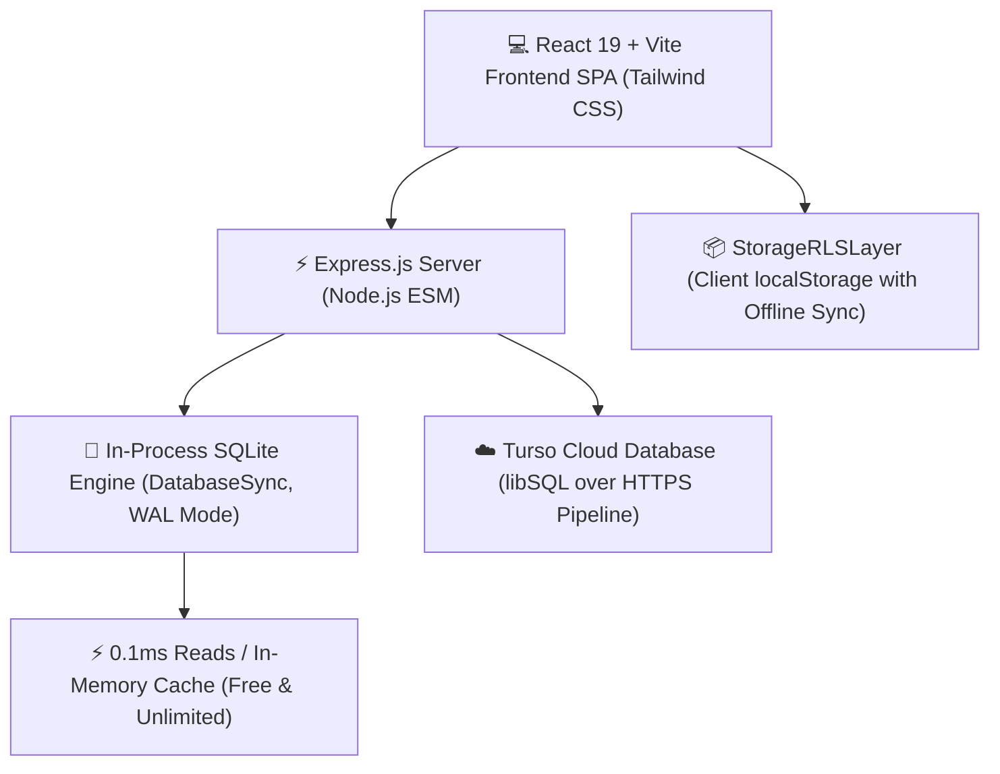

# 🧠 PROJECT_MEMORY.md — AcademicLevel Platform Knowledge Base
> **Note for AI Assistants / Antigravity Agents**:
> This file is the permanent memory and architectural source-of-truth for **AcademicLevel**.
> Whenever you start a fresh session on any machine or re-clone this repository, read this document first.
> It defines the core business rules, security gates, database behavior, and architectural patterns.

---

## 1. Project Overview & Identity

* **Platform Name**: AcademicLevel (`academiclevel-platform`)
* **Production Domain**: `academiclevel.in`
* **Repository**: [`https://github.com/nn1234s/academiclevel-platform.git`](https://github.com/nn1234s/academiclevel-platform.git)
* **Primary Branches**: `main` (production release) & `dev` (integration)
* **Mission**: High-performance, adaptive school curriculum mastery platform for **CBSE, ICSE, and Cambridge IGCSE (Classes 1 to 12)** with:
  * 24/7 Socratic Nova AI Tutor
  * Adaptive AI Quizzes & 12,000+ question curated offline syllabus banks
  * Automated post-quiz diagnostic performance reports delivered to an in-app student mailbox
  * Verifiable QR-coded annual certificates
  * Earnable Study Coin economy redeemable for real physical gifts & digital cards
* **Operating Legal Entity**:
  * Operated by **ZingQuark** (ZQ Technology — UDYAM Registration: `UDYAM-OD-19-0189385`).
  * Official Support & Dispute Email: `academiclevels@gmail.com`.

---

## 2. Core Architecture & Tech Stack



* **Frontend**:
  * React 19, TypeScript, Vite, Tailwind CSS, Lucide React icons.
  * State & Auth: `AuthContext.tsx` with multi-tab storage listeners and zero-flicker hydration.
  * Offline & Edge Sync: `StorageRLSLayer.ts` backing `localStorage` keys (`al_prod_*`).
* **Backend**:
  * Node.js (ESM), Express.js ([server/server.js](file:///server/server.js) & [server/api.js](file:///server/api.js)).
  * Trust Proxy enabled (`app.set('trust proxy', true)`) with enterprise security headers (`X-Frame-Options`, `X-Content-Type-Options`, `Referrer-Policy`).
* **Primary Database**:
  * In-process SQLite engine (`node:sqlite` `DatabaseSync`) located at `server/data/academiclevel_prod.db`.
  * High-concurrency pragmas enabled: `WAL` journal mode, `NORMAL` synchronous, `busy_timeout = 5000`, `cache_size = -64000`, composite indexes optimized for 30,000+ students.
* **Disaster Recovery & Cloud Replication**:
  * **Turso Cloud Database** via HTTP pipeline in [server/tursoClient.js](file:///server/tursoClient.js).

---

## 3. Strict Business & Commercial Policies

### A. Pricing Tiers & Official Payment Gateway
Payments are processed via the official UPI Payment Gateway hosted at `upipg.cit.org.in`:
1. **AcademicLevel Lite**: ₹49 for 60 Days (2 months) unlimited pass
   * Gateway URL: `https://upipg.cit.org.in/pay/erNAH4FIOAgE4qMpUDmI?public=true`
2. **AcademicLevel Plus**: ₹129 for 180 Days (6 months) unlimited pass
   * Gateway URL: `https://upipg.cit.org.in/pay/floCfjhckOsPisvVeVE0?public=true`
3. **AcademicLevel GOD Mode (3-Year VIP Pass)**: ₹450 for 1,095 Days (3 Full Years)
   * Supersedes legacy 1-Year Gold (₹205/365d) as the flagship tier.
   * Covers 3 full academic years (~₹12.50/mo, only ~41 paise/day!).
   * **Unit Economics & Guaranteed Physical Gift Fulfillment**:
     * Fulfilling a ₹100–₹130 physical reward on a ₹49 plan causes severe negative unit margins.
     * With the GOD 3-Year Plan at ₹450, a dedicated student accumulates ~20,000–25,000 coins over 2–3 years to redeem an insulated Milton bottle or authentic Pokémon set (~₹100–₹130 fulfillment + shipping cost).
     * AcademicLevel generates a **clean ₹320 to ₹350 net profit per subscriber**, sustainably and honestly fulfilling 100% of marketing promises!
   * Gateway URL: `https://upipg.cit.org.in/pay/2iHAbft8ENKjzPQvkfd8?public=true`
4. **School Institutional Pack**: ₹2,499
   * Includes 40 Lite or 20 Plus A-Code vouchers + School Portal with Class Weak-Point Analytics.
   * Gateway URL: `https://upipg.cit.org.in/pay/VucCVS8VRxJC9iQWEjVv?public=true`

### B. Daily Quiz Quotas & "⚡ Exam Mode" Governance
To protect young learners from cognitive fatigue while supporting high-stakes Board and Olympiad exams:
* **Classes 1 to 8 (Junior Scholars)**:
  * Normal Limit: **5 quizzes per calendar day**.
  * "⚡ Exam Mode": Turning ON Exam Mode immediately unlocks 5 additional quizzes (**10 quizzes total** per day).
* **Classes 9 to 12 (Senior Scholars)**:
  * Default Limit: **10 quizzes per calendar day** by default (eliminating parental complaints about artificial study caps during Board prep).
  * "⚡ Exam Mode": Turning ON Exam Mode increases the cap to **15 quizzes per day**.
* **Automatic Midnight Rollover**:
  * Tracked via `dailyQuizCount` and `dailyQuizDate` on the learner record.
  * When a new calendar day begins (`dailyQuizDate !== todayDate`), attempts automatically reset to 0.
* **UI Controls**:
  * Interactive "⚡ Exam Mode" toggle in `QuizEngine.tsx` top bar and `StudentDashboard.tsx` with live `quizzesToday / dailyLimit` counter and progress bar.
  * Friendly fatigue prevention modal offering 1-click Exam Mode enablement when standard limit is reached.

### C. Strict 20-Minute Full Refund Policy
* **Rule**: All subscriptions are eligible for a **100% full refund strictly within 20 minutes** of transaction time for accidental purchases, duplicate payments, or incorrect tier choices.
* **Procedure**: Users must email `academiclevels@gmail.com` within 20 minutes with their account email and bank transaction UTR reference. Requests within the 20-minute window are honored 100%.

### C. Study Coin Reward Economy
* **Welcome Bonus**: +10 coins on registration.
* **Quiz Mastery Reward**: +25 coins on scoring $\ge 70\%$ on any 10-question assessment.
* **Redemption**: Redeemable in the Gift Store for stationery, books, tech gadgets, or digital vouchers (includes worldwide shipping validation, even for remote polar research stations in Antarctica).

---

## 4. Non-Negotiable Security, Privacy & Integrity Rules

> [!IMPORTANT]
> The following rules must NEVER be bypassed, relaxed, or violated by any AI assistant or code edit:

1. **Zero Plaintext Admin Credentials**:
   * The codebase is public on GitHub. **Never** hardcode plaintext admin passwords, root tokens, or unhashed keys.
   * All administrative passkey validation must use backend SHA-256 cryptographic verification.
2. **Strict Student & Teacher Account Isolation**:
   * Student accounts are strictly segregated from Teacher and Admin accounts.
   * Students can **never** access teacher dashboards, inspect quiz question answer keys in advance, or bypass assessment anti-cheat timers.
   * Insecure "1-click teacher mode with student password" patterns must never be reintroduced.
3. **No Automated User Deletions (Zero-Purge Guarantee)**:
   * **Never** run automated `DELETE FROM learners` routines on boot or during Turso sync.
   * Student accounts are permanent and can **only** be deleted via:
     * Google Play-mandated self-service account deletion initiated by the user.
     * Explicit Super-Admin deletion inside the protected Admin Vault.
4. **Permanent Session Longevity (365-Day Validity)**:
   * Auth session tokens have 365-day validity (`Date.now() + 365 * 24 * 60 * 60 * 1000`).
   * Never run background cron scripts that aggressively purge active user sessions, as this causes worldwide users to get logged out and panic thinking their accounts were wiped.
5. **No Client-Side Account Suppression**:
   * The function `isTestOrDummyAccount()` must **always return `false`**.
   * Never filter out real students whose names or emails start with `kid_`, `aarav_`, `bhavya_`, `scholar_`, or test prefixes from the admin panel or client state.
6. **Admin Payment Verification Queue Transparency**:
   * [PaymentVerificationQueue.tsx](file:///src/admin-vault/modules/PaymentVerificationQueue.tsx) must default to the **`All Buyers`** tab (`filterTab: 'ALL'`).
   * Because automated UPI PG payments are marked `ACTIVE`, they must be visible front-and-center alongside manual `PENDING_VERIFICATION` items.

---

## 5. Turso Cloud "Free Forever" Quota Architecture

The platform operates on **Turso's Current Free Plan ($0/mo)**:
* **Total Storage**: **5 GB** (supports 50,000–100,000 active student accounts)
* **Row Writes / Month**: **10 Million** (supports ~22,000–25,000 Daily Active Users taking quizzes)
* **Row Reads / Month**: **500 Million** (our app uses ~0 reads during live browsing thanks to local SQLite WAL caching)
* **Database Limit**: **100 DBs** (AcademicLevel uses only 1)
* **Embedded Syncs**: **3 GB / month** (efficient delta-only sync)
* **Point-in-Time Restore**: **1 day**

### How the System Stays 100% Free Forever:
1. **Zero Cloud Reads Charged**:
   * 100% of read traffic (quiz questions, dashboard stats, leaderboards, user profile lookups) hits the **in-process SQLite WAL cache** at `0.1ms`.
   * Turso is never queried for reads during live browsing; cloud reads occur only during container cold-start hydration (`pullAllFromTurso`).
2. **Zero-Write-Amplification Dirty Tracking (`syncedRowHashes`)**:
   * In [server/tursoClient.js](file:///server/tursoClient.js), every row is tracked with an MD5 content hash.
   * If row content is unchanged, **0 writes are sent to Turso**.
   * Updates are buffered and flushed in chunks of 50 (`executeTursoBatch`) over 1.5-second debounced windows.
3. **Storage Preservation & Housekeeping**:
   * Rich post-quiz diagnostic JSON report payloads are stored in local SQLite and client `localStorage`, not replicated to Turso cloud.
   * Automated maintenance (`runAutomatedMaintenance`) purges security audit logs older than 90 days and compacts the SQLite WAL file via `PRAGMA wal_checkpoint(PASSIVE)`.

---

## 6. Key Directory & Code Map

| Directory / File | Description & Purpose |
| :--- | :--- |
| `server/server.js` | Express app boot, reverse-proxy trust, security headers, Turso pull on boot, graceful flush on SIGTERM. |
| `server/api.js` | Core REST API router (`/api/auth/*`, `/api/students/*`, `/api/admin/*`, `/api/mailbox/*`, `/api/payments/*`). |
| `server/db.js` | SQLite database schema, WAL pragmas, composite indexes for 30k students, and JSON backup migrations. |
| `server/tursoClient.js` | Turso HTTP pipeline client, MD5 dirty tracker (`syncedRowHashes`), debounced batch write buffer. |
| `src/App.tsx` | Main React SPA router, opaque header dropdowns, Study Coin balance pill, live unread mailbox counter. |
| `src/core/types/index.ts` | Canonical TypeScript data types (`Learner`, `Subscription`, `MailboxMessage`, `QuizReportDetail`). |
| `src/core/storage/StorageRLSLayer.ts` | LocalStorage abstraction layer with role-based security isolation and bidirectional server sync. |
| `src/core/api/apiClient.ts` | Client HTTP SDK for authenticated API communication. |
| `src/modules/student/QuizEngine.tsx` | Adaptive quiz runner (Live Gemini AI + offline question bank) with auto-generated mailbox diagnostic reports. |
| `src/modules/student/StudentMailboxModal.tsx` | Split-view student mailbox with question-by-question review & 1-click Nova AI tutor follow-ups. |
| `src/modules/student/StudentDashboard.tsx` | Student portal home: streak tracker, coin balance, quick launch cards, and latest quiz report spotlight banner. |
| `src/modules/public/SchoolPortalPage.tsx` | Dedicated school portal for ₹2,499 institutional pack (40 Lite / 20 Plus A-Codes & weak-point tracking). |
| `src/modules/shared/WhatsDifferentFromChatGPT.tsx` | Comparison section embedded in ad pages explaining why structured curriculum mastery beats generic LLMs. |
| `src/admin-vault/` | Protected Super-Admin management suite (Payment Queue, Learner Controls, A-Code Manager, CMS). |
| `scripts/` | Comprehensive Node.js verification test suites (Security gates, A-Codes, School packs, Mailbox reports). |

---

## 7. How to Restore on a Brand-New Machine

If you are ever setting up this project from scratch:
```bash
# 1. Clone repository
git clone https://github.com/nn1234s/academiclevel-platform.git
cd academiclevel-platform

# 2. Install dependencies
npm install

# 3. Configure environment variables (.env)
# TURSO_DATABASE_URL=libsql://...
# TURSO_AUTH_TOKEN=...
# GEMINI_API_KEY=...
# PORT=3000

# 4. Verify test suites
node scripts/test_student_mailbox_reports_suite.mjs
node scripts/test_school_pack_and_acode_flow.mjs
node scripts/test_security_gates.mjs

# 5. Build & run
npm run build
npm start
```
