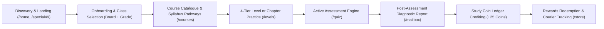

# AcademicLevel — User Journeys & Experience Architecture

**Document ID:** AL-EXP-0001  
**Created:** 2026-11-23  
**Status:** VERIFIED — IMPLEMENTED  
**Classification:** Experience Architecture & Service Blueprints  
**Owner:** UX Architect & Senior Full-Stack Engineer  

---

## 1. Macro Student Lifecycle Journey

### Stage Description & User State Transitions
1. **Discovery & Onboarding:** Unauthenticated visitors explore the curriculum showcase or Special 49 offer. First-time registration initializes student with 10 bonus coins, grade assignment (Classes 1–12), and active 60-day Concept Booster pass or 3-level free quota.
2. **Subject & Pathway Selection:** The student chooses between Math, CS, Science, English, or Social Studies, reviewing their mastery progress ring and unlocked tiers.
3. **Curriculum Assessment:** The student tackles 10 to 15 curriculum-aligned MCQs with a 1-second anti-cheat reading dwell guard. Immediate feedback indicates correctness with emerald green or rose red styling.
4. **Diagnostic Feedback:** On submission, results are compiled into a comprehensive `QuizReportDetail` message delivered directly to the in-app Student Mailbox, highlighting accuracy, dwell seconds, and conceptual remedies.
5. **Milestone Rewards:** Achieving >= 70% accuracy qualifies the student for +25 Study Coins, level completion badge, and updated streak records.
6. **Reward Redemption:** Accumulating coins allows students to redeem physical items in the Gift Store, initiating an admin-verified order dispatched via courier with live AWB tracking.

---

## 2. Service Blueprint

The table below maps the primary student touchpoints to frontend UI components, client state, backend APIs, and database persistence:

| User Action / Touchpoint | Frontend UI Component | Client State / RLS | Backend API Endpoint | Database Table | External / System Side-Effect |
| :--- | :--- | :--- | :--- | :--- | :--- |
| **Select Subject & Node** | [`CourseLevels.tsx`](../../src/modules/student/CourseLevels.tsx) | `activeSubjectId`, `activeLevelNode`, `quota` | `/api/quizzes/fetch-quiz` | `question_bank` | Serves exact advertised count (10/12/15) |
| **Answer Question** | [`QuizEngine.tsx`](../../src/modules/student/QuizEngine.tsx) | `selectedOption`, `answersLog`, `score` | None (Client interaction) | `sessionStorage` | 1s anti-cheat dwell guard validation |
| **Submit Question** | [`QuizEngine.tsx`](../../src/modules/student/QuizEngine.tsx) | `isAnswerSubmitted`, `score + 1` | None (Client evaluation) | `sessionStorage` | Type-cast `Number(correctIndex)` comparison |
| **Advance Question** | [`QuizEngine.tsx`](../../src/modules/student/QuizEngine.tsx) | `currentIndex + 1`, `dwell = 0` | None | `sessionStorage` | Auto-scroll to top with 90px sticky header offset |
| **Mid-Quiz Exit Attempt** | In-App Exit Modal in [`App.tsx`](../../src/App.tsx#L1997) | `quizExitModalOpen`, `pendingQuizExit` | None | `sessionStorage` | Preserves in-progress state; blocks false completion |
| **Finish Full Quiz** | [`QuizEngine.tsx`](../../src/modules/student/QuizEngine.tsx) | `isCompleted = true`, `rewardResult` | `/api/quizzes/attempt`, `/api/progress/level` | `quiz_attempts`, `course_progress`, `coin_ledger` | Records attempt, updates level counter, sends mailbox report |
| **Spin Daily Wheel** | [`DailySpinWheel.tsx`](../../src/modules/student/DailySpinWheel.tsx) | `isSpinning`, `wheelRotationDeg` | `/api/students/:id/spin` | `learners`, `coin_ledger` | Multi-spin normalized rotation to quadrant center |
| **Ask Nova AI** | [`NovaAiTutor.tsx`](../../src/modules/student/NovaAiTutor.tsx) | `chatHistory`, `userPrompt` | `/api/ai/chat` | `ai_quota`, `security_audit_logs` | Socratic response via Gemini or zero-credit fallback bank |
| **Redeem Doorstep Gift**| [`GiftStore.tsx`](../../src/modules/student/GiftStore.tsx) | `selectedItem`, `shippingAddress` | `/api/gifts/redeem` | `gift_requests`, `coin_ledger` | Deducts coins, generates Amazon fulfillment queue item |

---

## 3. UI Micro-Interactions & State Architecture

### Question Navigation & Screen Transitions
* **Instant Auto-Scroll:** When advancing to the next question, `scrollToQuizTop()` calculates `targetY = pageYOffset + rect.top - 90`, ensuring the mascot, question number, and prompt appear directly below the sticky navigation bar without visual clipping or floating.
* **Dual Action Buttons:** Submit Answer and Next Question buttons are rendered at both the top of the answer interaction area (immediately below question prompt) and the action footer, accommodating mobile and desktop viewports.
* **Exit Confirmation Flow:**
  - *Trigger:* Header back buttons, navigation links, or explicit "Exit" button in `QuizEngine.tsx`.
  - *Primary Button:* "Continue Assessment" (keeps quiz active, dismisses modal).
  - *Secondary Button:* "Leave Assessment" (exits without awarding completion rewards or Study Coins).
