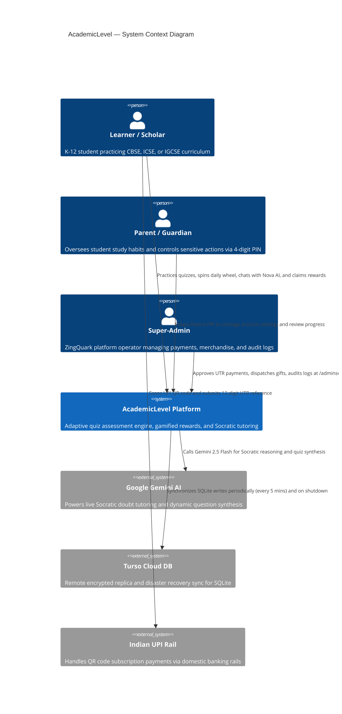
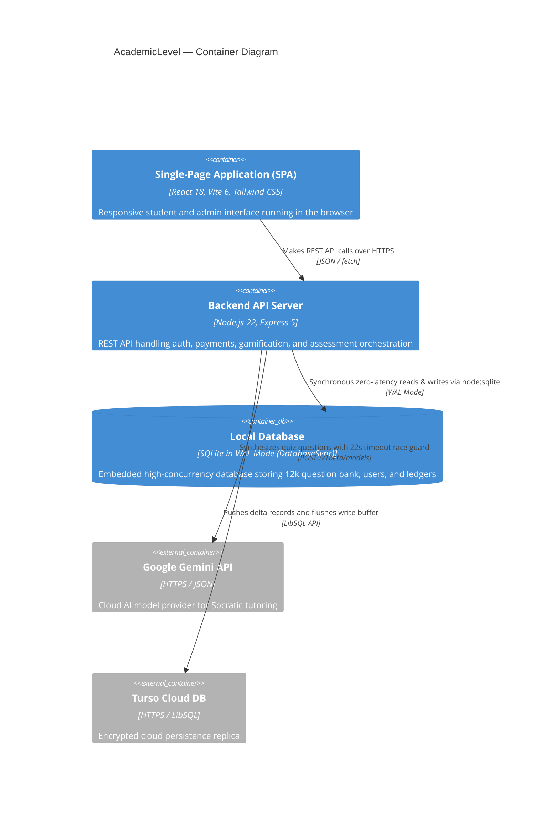
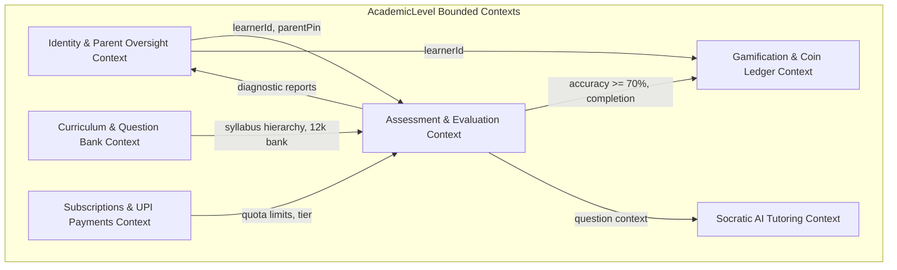

# AcademicLevel — System & Software Architecture

**Document ID:** AL-ARCH-0001  
**Created:** 2026-11-23  
**Status:** VERIFIED — IMPLEMENTED  
**Classification:** Core System Architecture  
**Owner:** Principal Software Architect  

---

## 1. C4 Architecture Models

### 1.1 C4 Level 1: System Context Diagram



---

### 1.2 C4 Level 2: Container Diagram



---

### 1.3 C4 Level 3: Core Component Architecture

Within the React SPA and Express backend, components are organized cleanly by responsibility:

```text
src/
├── core/
│   ├── api/apiClient.ts                ← HTTP client with automated fallback
│   ├── auth/AuthContext.tsx            ← Session management, role guards, token sync
│   ├── storage/StorageRLSLayer.ts      ← Client Row-Level Security & local persistence
│   ├── theme/classThemes.ts            ← NEP 2020 persona styling & color palettes
│   └── types/index.ts                  ← Strict TypeScript domain entity schemas
│
├── services/
│   ├── curriculumService.ts            ← Subject catalogues, grade mappings, chapters
│   ├── hybridQuizService.ts            ← Live AI synthesis + offline bank fallback
│   ├── offlineBankService.ts           ← Local syllabus bank queries & synthetic generators
│   ├── quotaService.ts                 ← Entitlement limits & 3-level free tier evaluation
│   ├── coinLedgerService.ts            ← Gamified ledger transactions & spin wheel cooldowns
│   └── certificateService.ts           ← Verifiable SHA-256 certificate generation
│
└── modules/
    ├── student/                        ← StudentDashboard, QuizEngine, NovaAiTutor, etc.
    ├── public/                         ← LandingPage, PricingPage, Special49AdsLandingPage
    ├── shared/                         ← ErrorBoundary, PaywallGateModal, AuthModal
    └── admin-vault/                    ← AdminVaultShell and management modules
```

---

## 2. Domain-Driven Design (DDD) Bounded Contexts



1. **Identity & Parent Oversight Context:** Owns `learners`, credentials, parent PIN hashes, and RLS session keys.
2. **Curriculum & Question Bank Context:** Owns board structures (`CBSE`, `ICSE`, `IGCSE`), 12 grade levels, subjects, chapters, and the 12,000 verified question records in `question_bank`.
3. **Assessment & Evaluation Context:** Owns quiz session state, 1-second bot dwell timers, question count verification, answer integrity evaluation, and `quiz_attempts`.
4. **Gamification & Coin Ledger Context:** Owns `coin_ledger`, daily spin wheel cooldowns, streak freezes, and `gift_requests` physical merchandise redemptions.
5. **Subscriptions & UPI Payments Context:** Owns `subscriptions`, 12-digit UTR references, A-Codes prepaid vouchers, and super-admin approval queues.
6. **Socratic AI Tutoring Context:** Owns Nova AI system instructions, Gemini chat endpoints, student message quotas, and transparent offline curriculum fallback banks.
