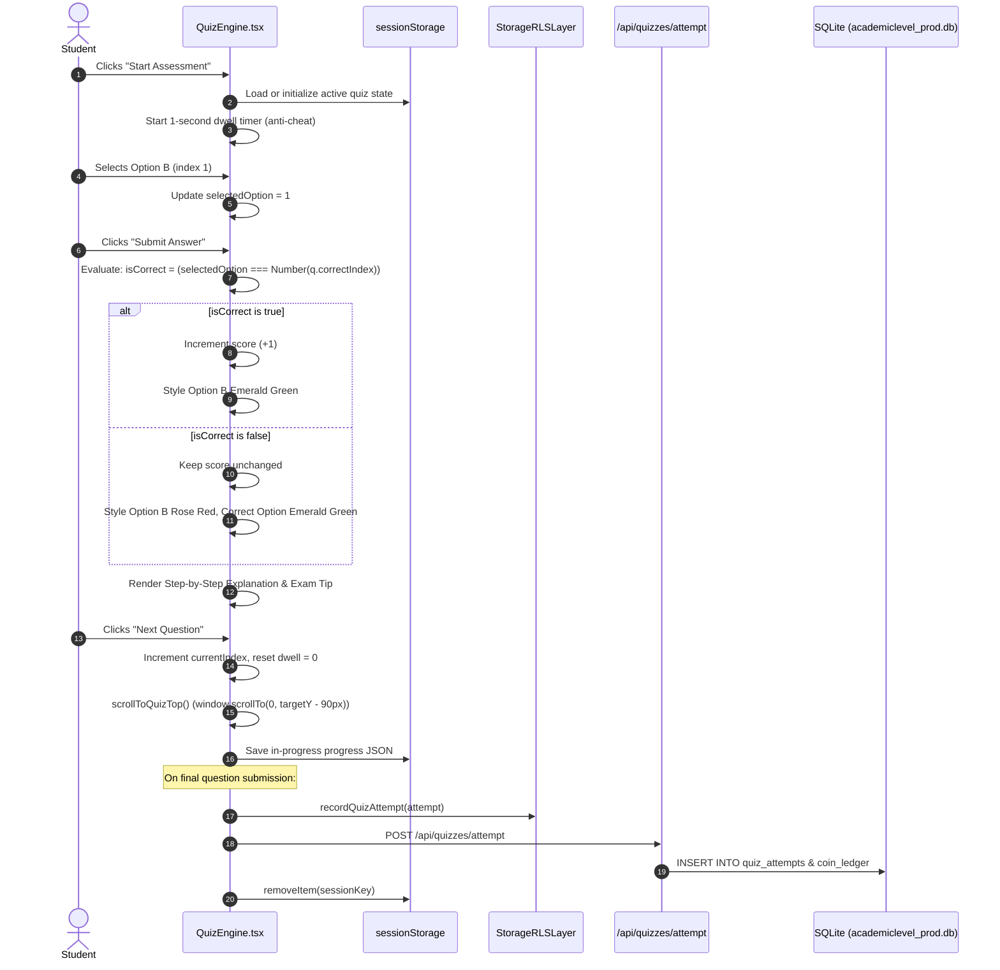
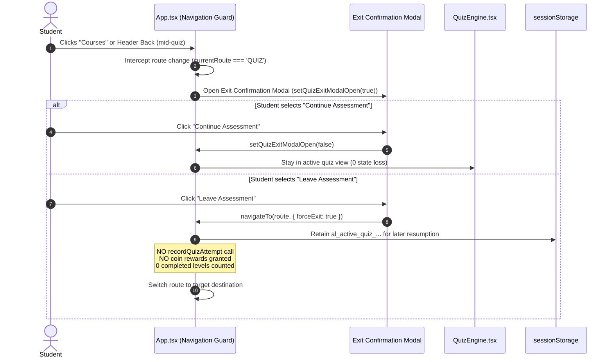
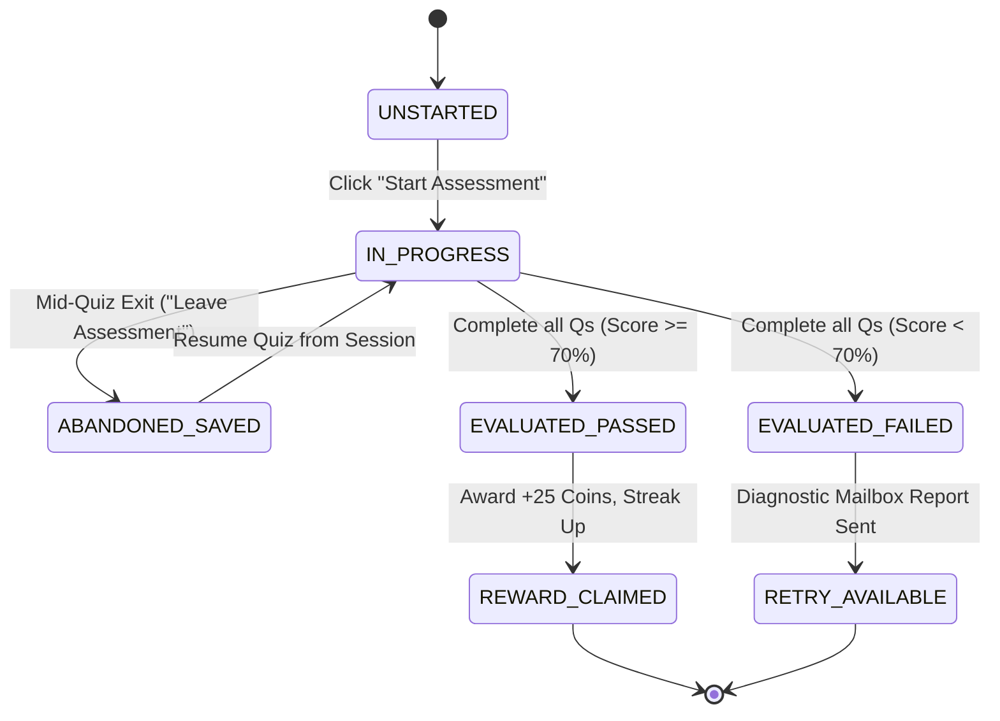
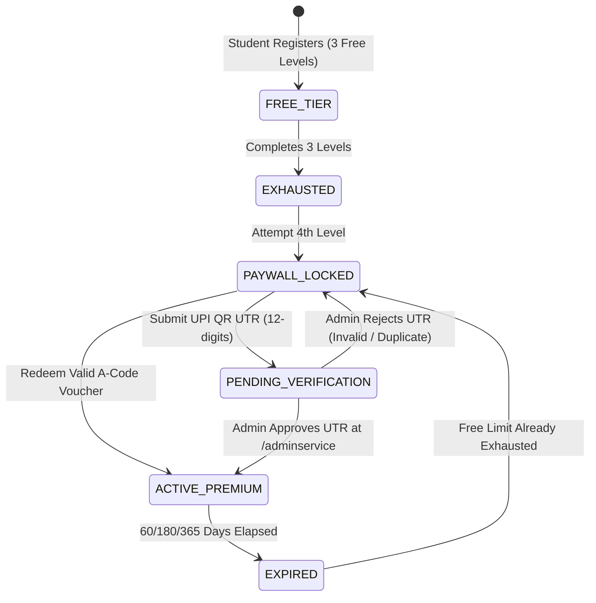

# AcademicLevel — Behavioral & Runtime Architecture

**Document ID:** AL-RNTM-0001  
**Created:** 2026-11-23  
**Status:** VERIFIED — IMPLEMENTED  
**Classification:** Runtime Systems Architecture  
**Owner:** Senior Full-Stack Engineer & SRE Lead  

---

## 1. Runtime Sequence Diagrams

### 1.1 Quiz Execution, Evaluation, and Auto-Scroll Flow

---

### 1.2 Incomplete Assessment Exit Protection Flow

---

## 2. State Machine Diagrams

### 2.1 Quiz Attempt State Transitions

### 2.2 Subscription & Payment State Transitions

---

## 3. Failure Mode and Effects Analysis (FMEA)

| Failure Mode | Root Cause | Potential Severity | Detection Mechanism | Built-In System Mitigation | Verified Evidence |
| :--- | :--- | :--- | :--- | :--- | :--- |
| **Gemini AI Service Timeout** | Cloud provider latency or rate limit | Moderate | 22-second `Promise.race()` timeout in `hybridQuizService.ts` | Automatically falls back to 12,000-question SQLite question bank (`CURATED_OFFLINE`) | `test_student_behavioral_suite.mjs` (Step 13 & 14) |
| **Accidental Browser Refresh** | Student refreshes page mid-assessment | High | `sessionStorage` key lookup on component mount | In-progress state automatically restores question bank, index, and score | `QuizEngine.tsx` lines 126–143 |
| **Rapid Bot Clicking** | Automated script answering < 1s | High | 1-second dwell guard in `QuizEngine.tsx` | Disables "Submit Answer" button until dwell >= 1s; increments `antiCheatViolations` | `QuizEngine.tsx` lines 276–278 |
| **SQLite Concurrent Lock** | Concurrent writes on high-traffic bursts | Moderate | Busy handler (`busy_timeout = 5000`) | WAL mode enables non-blocking readers; writers queue for up to 5000ms | `server/db.js` PRAGMA busy_timeout |
| **Spin Wheel Angular Drift** | Accumulation of previous rotation angles | Low | Cumulative degree evaluation | Normalizes target degrees modulo 360° relative to current normalized wheel angle | `DailySpinWheel.tsx` lines 86–91 |
