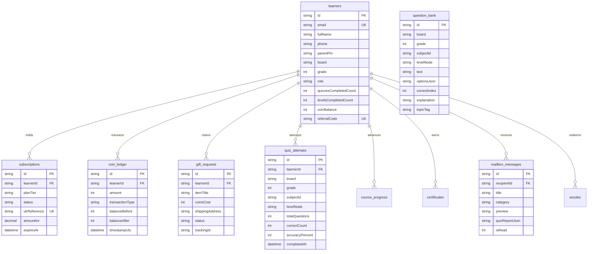

# AcademicLevel — Data Dictionary & API Specifications

**Document ID:** AL-DATA-0002  
**Created:** 2026-11-23  
**Status:** VERIFIED — IMPLEMENTED  
**Classification:** Data Architecture & API Contracts  
**Owner:** Database & Data Architect  

---

## 1. Entity-Relationship Diagram (ERD)



---

## 2. Core Data Dictionary

### Table: `learners`
*Primary user entity representing student scholars.*

| Column | Type | Nullable | Constraints / Defaults | PII Classification | Description |
| :--- | :--- | :--- | :--- | :--- | :--- |
| `id` | `TEXT` | No | Primary Key | Pseudonymous ID | Unique identifier (`lrn_...`) |
| `email` | `TEXT` | No | Unique | Direct PII | Student login email |
| `fullName` | `TEXT` | No | None | Direct PII | Student display name |
| `phone` | `TEXT` | Yes | None | Direct PII | Contact mobile number |
| `parentName` | `TEXT` | Yes | None | Direct PII | Parent / guardian name |
| `parentEmail`| `TEXT` | Yes | None | Direct PII | Parent notification email |
| `parentPin` | `TEXT` | Yes | 4-digit hash | Sensitive Credential | Parent access control PIN |
| `board` | `TEXT` | No | `CBSE`, `ICSE`, `IGCSE` | Non-PII | Educational board |
| `grade` | `INTEGER` | No | Range 1 to 12 | Non-PII | Academic school class |
| `role` | `TEXT` | No | Default `'STUDENT'` | Operational | Access role (`STUDENT`, `SUPER_ADMIN`) |
| `coinBalance` | `INTEGER` | No | Default `10` | Financial | Available Study Coins |
| `referralCode`| `TEXT` | No | Unique | Operational | Referral code (e.g. `AL-...`) |

### Table: `subscriptions`
*Financial entitlements and payment verification queue.*

| Column | Type | Nullable | Constraints / Defaults | PII Classification | Description |
| :--- | :--- | :--- | :--- | :--- | :--- |
| `id` | `TEXT` | No | Primary Key | Operational | Subscription record ID |
| `learnerId` | `TEXT` | No | Foreign Key (`learners.id`) | Pseudonymous ID | Beneficiary student |
| `planTier` | `TEXT` | No | `LITE`, `PLUS`, `GOLD` | Commercial | Active plan package |
| `status` | `TEXT` | No | `ACTIVE`, `PENDING_VERIFICATION` | Commercial | Payment approval state |
| `utrReference`| `TEXT` | No | Unique (12 digits) | Financial Record | Indian banking UTR reference |
| `amountInr` | `NUMERIC` | No | ₹49, ₹129, ₹205 | Financial Record | Payment value |
| `expiresAt` | `TEXT` | No | ISO 8601 | Operational | Access expiry timestamp |

### Table: `question_bank`
*12,000 curriculum assessment items.*

| Column | Type | Nullable | Constraints / Defaults | Description |
| :--- | :--- | :--- | :--- | :--- |
| `id` | `TEXT` | No | Primary Key | Unique question ID (e.g. `q_cbse_10_m_...`) |
| `board` | `TEXT` | No | `CBSE`, `ICSE`, `IGCSE` | Target board syllabus |
| `grade` | `INTEGER` | No | 1 to 12 | Grade level |
| `subjectId` | `TEXT` | No | `math`, `cs`, `science`, `english`, `social` | Subject category |
| `levelNode` | `TEXT` | No | `FOUNDATION`, `CONCEPT`, `EXAM_READY`, `OLYMPIAD` | Difficulty tier |
| `text` | `TEXT` | No | Non-empty | Question statement |
| `optionsJson` | `TEXT` | No | JSON array (4 strings) | Multiple choice options |
| `correctIndex`| `INTEGER` | No | 0, 1, 2, or 3 | Zero-based index of correct option |
| `explanation` | `TEXT` | Yes | Non-empty | Pedagogical step-by-step solution |
| `topicTag` | `TEXT` | Yes | Non-empty | Chapter name (e.g. "Trigonometry", "Addition") |

---

## 3. OpenAPI 3.0 REST Specification Excerpt

```yaml
openapi: 3.0.3
info:
  title: AcademicLevel Core Platform API
  version: 2.15.1
paths:
  /api/quizzes/fetch-quiz:
    get:
      summary: Retrieve syllabus-aligned questions for assessment
      parameters:
        - name: board
          in: query
          required: true
          schema: { type: string, enum: [CBSE, ICSE, IGCSE] }
        - name: grade
          in: query
          required: true
          schema: { type: integer, minimum: 1, maximum: 12 }
        - name: subjectId
          in: query
          required: true
          schema: { type: string }
        - name: levelNode
          in: query
          required: true
          schema: { type: string, enum: [FOUNDATION, CONCEPT, EXAM_READY, OLYMPIAD] }
        - name: count
          in: query
          required: false
          schema: { type: integer, default: 10 }
        - name: chapter
          in: query
          required: false
          schema: { type: string }
      responses:
        '200':
          description: Successfully fetched matching questions
          content:
            application/json:
              schema:
                type: object
                properties:
                  success: { type: boolean }
                  count: { type: integer }
                  questions:
                    type: array
                    items:
                      type: object
                      properties:
                        id: { type: string }
                        text: { type: string }
                        options: { type: array, items: { type: string } }
                        correctIndex: { type: integer }
                        explanation: { type: string }
                        topicTag: { type: string }

  /api/ai/chat:
    post:
      summary: Socratic guidance from Nova AI Tutor
      requestBody:
        required: true
        content:
          application/json:
            schema:
              type: object
              required: [query]
              properties:
                query: { type: string }
                subject: { type: string }
                grade: { type: integer }
                board: { type: string }
      responses:
        '200':
          description: Socratic response
          content:
            application/json:
              schema:
                type: object
                properties:
                  success: { type: boolean }
                  text: { type: string }
                  source: { type: string, enum: [GEMINI_LIVE, STATIC_CURRICULUM_FALLBACK] }
                  isFallback: { type: boolean }
```
