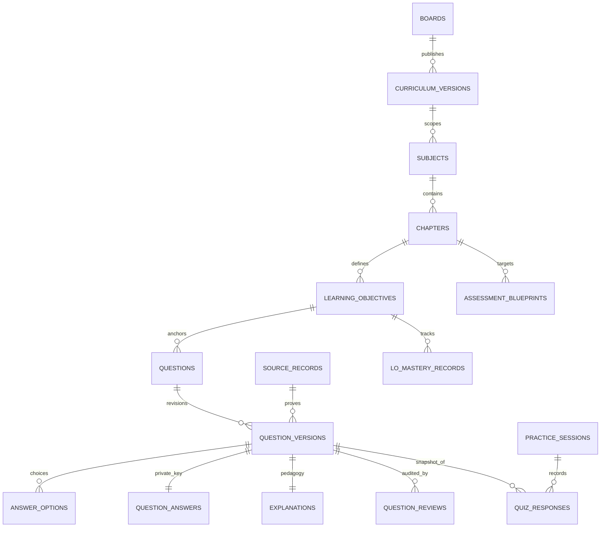

# Question Bank & Mastery Normalized Production Data Schema

**Document ID:** AL-STD-0008  
**Created:** 2026-11-25  
**Status:** DESIGNED — TARGET ARCHITECTURE (Migration Added in Phase 6)  
**Classification:** Database Architecture Standard  
**Owner:** Database & Data Architect  

---

## 1. Core Data Separation Principle

AcademicLevel strictly isolates four persistence planes inside SQLite (`node:sqlite` WAL) + Turso HTTP pipeline replication so editing a question typo, translating copy, or updating a syllabus **never corrupts historical student attempt records or psychometric calibration**:

1. **Curriculum & Versioning Plane:** `boards`, `curriculum_versions`, `grade_levels`, `subjects`, `chapters`, `learning_objectives`, `assessment_blueprints`
2. **Immutable Item Content & Governance Plane:** `source_records`, `questions`, `question_versions`, `answer_options`, `question_answers`, `explanations`, `question_reviews`, `duplicate_groups`
3. **Student Practice, Responses & Telemetry Plane:** `practice_sessions`, `quiz_responses` (links `questionVersionId` immutably!), `item_defect_reports`
4. **Adaptive Mastery & Compliance Plane:** `lo_mastery_records`, `parental_consents`, `security_audit_logs`

## 2. Production Entity Definitions (`SQLite / LibSQL`)

| Table | Primary Key | Key Foreign Keys & Invariants | Purpose |
|---|---|---|---|
| `boards` | `id` (`CBSE`\|`CISCE`\|`IGCSE`) | `officialName`, `country`, `gradingScale` | Authoritative examination board catalogue |
| `curriculum_versions` | `id` (UUID/slug) | `boardId -> boards(id)`, `academicYear` (e.g. `2026-27`), `isImmutable`, `status` | Immutable syllabus manifest snapshots |
| `grade_levels` | `grade` (`1..12`) | `stageId` (`STAGE_1_FOUNDATION`..`STAGE_5_SENIOR`) | Age-progression classification |
| `subjects` | `id` | `boardId`, `curriculumVersionId`, `grade`, `officialCode`, `streamTag`, `category` (`CORE`\|`ELECTIVE`\|`LANGUAGE`\|`VOCATIONAL`) | Board-specific subject catalogue |
| `chapters` | `id` | `subjectId`, `chapterOrder`, `title`, `lifecycleState` (9 states), `completenessScore` | Chapter inventory & lifecycle |
| `learning_objectives` | `id` | `chapterId`, `code`, `description`, `bloomLevel`, `prerequisiteLoIdsJson`, `assessmentObjectiveCode` | Granular LO competency nodes |
| `source_records` | `id` | `boardId`, `curriculumVersionId`, `title`, `authorityUrl`, `sectionRef`, `verifiedAt` | Primary syllabus provenance |
| `questions` | `id` (UUID) | `learningObjectiveId`, `chapterId`, `boardId`, `grade`, `subjectId`, `lifecycleStatus`, `activeVersionId` | Canonical question identity |
| `question_versions` | `id` (UUID) | `questionId`, `versionNumber`, `stemText`, `stemHash`, `skeletonHash`, `questionFormat`, `estimatedDifficulty`, `empiricalDifficulty`, `assetClass`, `assetUrl`, `assetAltText`, `sourceRecordId`, `promptVersion`, `isValidationPassed` | Immutable versioned item content |
| `answer_options` | `id` | `questionVersionId`, `optionIndex` (`0..3`), `optionText`, `misconceptionTag` | Structured choices |
| `question_answers` | `questionVersionId` | `correctOptionIndex`, `numericTolerance`, `canonicalExpression`, `verificationMethod`, `verifiedAt` | **Server-only private answer keys — never serialized to active quiz client** |
| `explanations` | `questionVersionId` | `stepByStepMarkdown`, `hintText`, `commonMistakeNote` | Released only after item/attempt submission |
| `question_reviews` | `id` | `questionVersionId`, `reviewerId`, `decision`, `rubricJson`, `reviewedAt` (`reviewerId != authorId`) | Independent editorial sign-off |
| `duplicate_groups` | `id` | `canonicalQuestionId`, `memberQuestionId`, `matchTier`, `similarityScore`, `resolutionStatus` | Quarantine & dedup tracking |
| `assessment_blueprints` | `id` | `curriculumVersionId`, `boardId`, `grade`, `subjectId`, `paperCode`, `sectionsJson`, `totalMarks`, `durationMinutes`, `qaPassed` | Board specimen paper blueprints |
| `practice_sessions` | `id` | `learnerId`, `mode` (9 practice modes \| `BOARD_EXAM_SIM`), `boardId`, `grade`, `subjectId`, `chapterId`, `questionIdsJson`, `status`, `startedAt`, `expiresAt`, `submittedAt` | Authoritative stateful server quiz session |
| `quiz_responses` | `id` | `sessionId`, `learnerId`, `questionId`, `questionVersionId`, `learningObjectiveId`, `chosenOptionIndex`, `isCorrect`, `responseTimeMs`, `answerRevisionCount`, `respondedAt` | Item-level telemetry for CTT/IRT & analytics |
| `lo_mastery_records` | `id` (`UNIQUE(learnerId, learningObjectiveId)`) | `masteryStage` (6 stages), `masteryScore`, `signalsJson` (7 signals), `nextReviewAt`, `intervalDays`, `lastAssessedAt` | LO mastery & spaced revision state |

## 3. Compatibility Adapter & Safe Migration Rule

Because existing application queries read `question_bank`, migrations add all normalized tables cleanly via idempotent DDL (`CREATE TABLE IF NOT EXISTS`) + explicit versioned backfill scripts and rollback procedures without breaking live student records.
